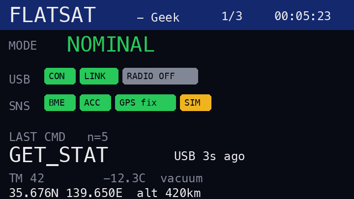

# FlatSat-Geek

Pwnsat/FlatSat firmware, adapted for the Waveshare RP2350-GEEK: no radio hardware,
and a status screen on the 1.14" LCD.

Based on [Pwnsat/FlatSat](https://github.com/cromulencellc/hackasat-final-2020)
(GPL-2.0-or-later). See [License](#license) for attribution and a list of
changes.

Build (needs PlatformIO):

    cd Firmware
    pio run -e pico2_geek_norf        # -> .pio/build/pico2_geek_norf/firmware.uf2

Prebuilt: `Firmware/build/flatsat-firmware-rp2350-geek.uf2`. Hold BOOTSEL while
plugging in USB, copy the .uf2 onto the drive.

## Simulated sensors (`pico2_geek_sim`)

For a board with no sensors attached: BME280, LIS2DH12 and GPS values are
simulated (`-DFLATSAT_SIM_SENSORS=1`). A real GPS that sends NMEA always wins.
The screen shows a `SIM` chip, and the boot log prints `[INFO] SIM: ...`.

    pio run -e pico2_geek_sim
    # prebuilt: Firmware/build/flatsat-firmware-rp2350-geek-sim.uf2

Simulated GPS (`-DFLATSAT_SIM_GPS_MODE=n`):

- `0` (default): a satellite on an ISS-like circular orbit (420 km, 51.6 deg,
  period ~92.8 min), see `orbit_sim.h`. Starts over Tokyo heading north-east.
  `-DFLATSAT_SIM_ORBIT_SPEEDUP=60` runs it 60x faster. The ground-station
  gate (35 km) opens only for a few seconds when the track passes over Las
  Vegas (first time about 21 min after boot, about 3 s).
- `1`: small fixed track over the ground station, gate stays open.
- `2`: small fixed track over Tokyo, gate stays closed.

Simulated environment (space-like):

- Temperature follows the orbit's sunlight/eclipse cycle: about -28 C coming
  out of shadow, about +65 C at the end of the sunlit arc, 37% of each orbit in
  eclipse. It speeds up with `-DFLATSAT_SIM_ORBIT_SPEEDUP`.
- Pressure and humidity read 0 (vacuum); altitude from the BME280 is reported
  as 0 because pressure altitude is meaningless in vacuum.
- The accelerometer reads micro-g (free fall): well under 1 mg of noise on
  each axis. Its temperature tracks the skin temperature with a lag.
- Tunables: `FLATSAT_SIM_T_HOT_C`, `FLATSAT_SIM_T_COLD_C`,
  `FLATSAT_SIM_T_TAU_S`, `FLATSAT_SIM_ECLIPSE_FRACTION`.

## Screen pages

The BOOT button on the RP2350-GEEK controls the screen:

- **Short press**: switch to the next page (page number shown at the top, e.g. `2/3`)
- **Long press (1 s)**: flip the display 180 degrees (useful when the board is mounted upside down)

The screen redraws at most twice a second. The flip also works during the
boot screen (`WAIT USB CONSOLE`).

### 1. Status

Main dashboard showing the overall satellite state at a glance.

- **MODE**: current mission mode (`SAFE` / `NOMINAL` / `PAYLOAD` / `SCIENCE` / `CONTINGENCY`). Colour-coded: SAFE = yellow, NOMINAL = green, CONTINGENCY = red. An `ARM` badge appears when the payload is armed.
- **USB**: connection status. `CON` (USB serial console) and `LINK` (radio-link emulation over USB) show green/red. `RADIO OFF` indicates radio hardware is compiled out. A `DBG` badge appears when USB debug is enabled.
- **SNS**: sensor status. `BME` (BME280 temperature/humidity/pressure), `ACC` (LIS2DH12 accelerometer), `GPS` (fix / nofix / quiet / none). A `SIM` badge appears in simulated-sensor mode. `GS AUTH` or `GS ON` appears during ground-station authentication.
- **LAST CMD**: last received command name, source (USB / RF), and time elapsed. The entire row highlights yellow for 1.5 s after reception.
- **TM**: telemetry packet count and environment (temperature, pressure; shows `vacuum` when pressure < 1 hPa).
- **Position**: GPS coordinates (latitude / longitude / altitude). Altitude is shown in km when above 10 km.

### 2. Attack scoreboard

Tracks student progress during satellite-attack exercises. Eight milestones:

| Milestone | Trigger |
|---|---|
| `RECON` | Any recon command received (PING, GET_STATUS, GET_NAV, PL_STAT, GS_STAT) |
| `MODE CHG` | SET_MISSION_MODE command received |
| `GS AUTH` | Ground-station session actually established (state) |
| `FLASH RD` | FLASH_READ command received |
| `AES CFG` | AES_CONFIG command received |
| `DEBUG ON` | USB debug actually enabled (state) |
| `ARMED` | Payload actually armed (state) |
| `THRUSTER` | SET_THRUSTER command received |

Command milestones (RECON, MODE CHG, FLASH RD, AES CFG, THRUSTER) tick when
the command is received. State milestones (GS AUTH, DEBUG ON, ARMED) tick only
when the satellite is actually in that state. A newly reached milestone is
highlighted for 3 s. All counters reset on reboot.

### 3. System

Detailed system information.

- **RESET**: reset reason (power-on / watchdog or soft reset via RESETC / brown-out / RUN pin)
- **UPTIME**: time since boot
- **HEAP**: free heap memory in bytes
- **TM / CMD**: telemetry packets sent / commands received
- **ENV**: environment sensor readings (temperature, pressure; shows `vacuum` when pressure < 1 hPa)
- **VERSION**: firmware version (`FW_VERSION` in `version.h`) + build number (git commit count) + git short hash (`+` appended if the working tree had local changes)
- **BUILT**: build date and time (all filled in automatically by `tools/gen_version.py`)

## License

This project is licensed under the **GNU General Public License v2.0 or later**
(GPL-2.0-or-later). See [LICENSE](LICENSE) for the full text.

### Original work

The firmware is derived from
[Pwnsat/FlatSat](https://github.com/cromulencellc/hackasat-final-2020)
by **astrobyte** (Cromulence / Hack-A-Sat), originally released under
GPL-2.0-or-later.

### Changes in this repository

- `radio_off.h/.cpp`, `#if FLATSAT_NO_RADIO`: SX1262 radios compiled out and
  held in hardware reset
- `lcd_status.h/.cpp`, `#if FLATSAT_LCD_GEEK`: 1.14" LCD status screen
  (status page, attack scoreboard, system info, 180-degree flip via MADCTL).
  SPI1 pins: DC=GP8 CS=GP9 CLK=GP10 MOSI=GP11 RST=GP12 BL=GP25
- `orbit_sim.h`, `sensors.cpp` with `FLATSAT_SIM_SENSORS`: simulated BME280,
  LIS2DH12 and GPS (ISS-like orbit with thermal model)
- `platformio.ini`: RP2350 / Pico 2 build environments
  (`pico2_tinyusb_norf`, `pico2_geek_norf`, `pico2_geek_sim`)
- `version.h`, `tools/gen_version.py`: build-time version injection
