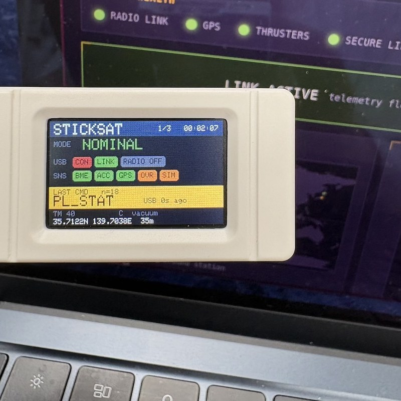
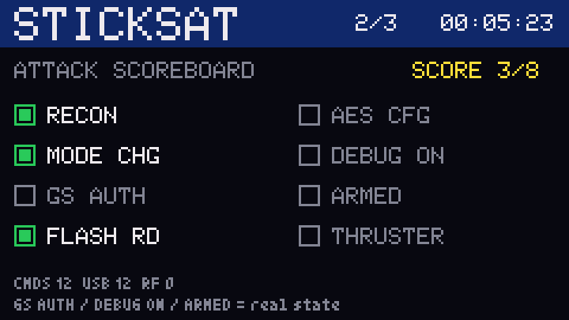
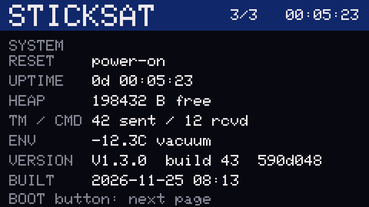

# StickSat

[Japanese / 日本語](README_ja.md)

Formerly **FlatSat-Geek** (renamed in v1.3.0).

Pwnsat/FlatSat firmware, adapted for the Waveshare RP2350-GEEK and RP2040-GEEK:
no radio hardware, and a status screen on the 1.14" LCD.



Based on [Pwnsat/FlatSat](https://github.com/Pwnsat/FlatSat)
(GPL-2.0-or-later). See [License](#license) for attribution and a list of
changes.

Build (needs PlatformIO):

    cd Firmware
    pio run -e pico2_geek_norf        # RP2350-GEEK -> .pio/build/pico2_geek_norf/sticksat-*.uf2
    pio run -e pico_geek_norf         # RP2040-GEEK -> .pio/build/pico_geek_norf/sticksat-*.uf2

Flash: hold BOOTSEL while plugging in USB, copy the `.uf2` onto the drive.
Prebuilt UF2s are attached to each
[GitHub release](https://github.com/bellx2/StickSat/releases):
`sticksat-pico2_geek_sim-*.uf2` for the RP2350-GEEK,
`sticksat-pico_geek_sim-*.uf2` for the RP2040-GEEK (since v1.3.1). The two
boards share the LCD wiring; the UF2 for one chip does not run on the other.

Release: bump `FW_VERSION` in `Firmware/version.h`, add the version to
`CHANGELOG.md`, then push a matching tag (`git tag v1.2.0 && git push origin v1.2.0`).
GitHub Actions (`.github/workflows/release.yml`) builds `pico2_geek_sim` and
`pico_geek_sim` and creates the release with both UF2s and that version's
CHANGELOG section. The
workflow stops if the tag does not match `FW_VERSION`.

## Functional check

`Firmware/tools/board_check.py` checks that a flashed board works, over USB.
It covers what you cannot see on the screen: the USB identity and
firmware version, replies to the read-only commands (PING, SEND_FW,
GET_STATUS, GET_NAV, GET_PAYLOAD_STATUS, GS_STATUS), the IDS events, 20 PING
round trips, the periodic telemetry, and the state of a freshly booted board
(NOMINAL, AES secure link on, debug off, GPS override at Tokyo, GS mode off). It changes
nothing on the board. Needs [uv](https://docs.astral.sh/uv/).

    cd Firmware
    tools/board_check.py                # or: uv run tools/board_check.py

It prints PASS/FAIL per check and exits non-zero on any failure. It expects
the `pico2_geek_sim` build: without simulated sensors the BME280 and
accelerometer checks fail. With several boards connected, pick one with
`--serial fsat-<chip id>`. `--link` and `--console` set the ports by hand.
The script ends by listing what the screen should show. Check that by eye,
then replug the board to clear the counters.

## Simulated sensors (`pico2_geek_sim`)

For a board with no sensors attached: BME280, LIS2DH12 and GPS values are
simulated (`-DFLATSAT_SIM_SENSORS=1`). A real GPS that sends NMEA always wins.
The screen shows a `SIM` chip, and the boot log prints `[INFO] SIM: ...`.

    pio run -e pico2_geek_sim

Ground station and starting position (same as JP-Bootcamp): the ground
station is in Sapporo (43.0618N, 141.3545E, 35 km radius). The board boots
with the GPS override active at Tokyo (35.7122N, 139.7038E), about 830 km
away, so the gate starts closed and only opens after the position is spoofed
with `TC_GPS_OVERRIDE` (APID 0x14).

While the override is active the simulated GPS below is not used. Send
`TC_GPS_OVERRIDE` with a 1-octet payload `0x00` to clear it: the sim build
goes back to the simulated orbit, a board with a real GPS goes back to its
NMEA position. Sending a 13-octet position sets the override again. Like other
commands, it is refused while the ground-station gate is closed. A reset
restores the Tokyo override.

Simulated GPS (`-DFLATSAT_SIM_GPS_MODE=n`, used only without the override):

- `0` (default): circular orbit near Sapporo (period 10 min, altitude
  420 km). In the ground-station gate (35 km) for ~4 min, then ~6 min out of
  range, repeating.
- `1`: small fixed track over the ground station (Sapporo), gate stays open.
- `2`: small fixed track over Tokyo, gate stays closed.

Simulated environment (space-like):

- Temperature follows the orbit's sunlight/eclipse cycle: about -28 C coming
  out of shadow, about +65 C at the end of the sunlit arc, 37% of each orbit in
  eclipse. It speeds up with `-DFLATSAT_SIM_ORBIT_SPEEDUP`.
- Pressure and humidity read 0 (vacuum); altitude from the BME280 is reported
  as 0 because pressure altitude is meaningless in vacuum.
- The accelerometer reads micro-g (free fall): well under 1 mg of noise on
  each axis. Its temperature tracks the skin temperature with a lag.
- Tunables: `FLATSAT_SIM_T_HOT_C`, `FLATSAT_SIM_T_COLD_C`,
  `FLATSAT_SIM_T_TAU_S`, `FLATSAT_SIM_ECLIPSE_FRACTION`.

## Attack exercises

Compatibility with the
[original attack scripts](https://github.com/Pwnsat/FlatSat/tree/main/Attacks)
on the RP2350-GEEK (USB only, no radio):

| # | Attack | USB | Notes |
|---|---|---|---|
| 00 | APID Enumeration | Yes | |
| 01 | Eavesdropping | Yes | Capture telemetry from USB instead of RF |
| 02 | Fuzzing / Crash | Partial | Command accepted but transmission blocked (`RADIO DISABLED`) |
| 03 | Command Injection | Yes | |
| 04 | GPS Spoofing | Yes | `TC_GPS_OVERRIDE` (APID 0x14) injects a position over USB |
| 05 | GS Auth Spoofing | Conditional | Needs GPS within ground-station range (Sapporo, 35 km); spoof the position first with attack 04 |
| 06 | Replay | Yes | |
| 07 | RESETC | Yes | |

## JP-Bootcamp

Since v1.2.0 this firmware speaks the same protocol as the
[JP-Bootcamp](https://github.com/r0r0x-xx/JP-Bootcamp) course firmware
(v1.0.5), so its Space IDS, PWNSAT-C3 console and attack scripts can be used
against the RP2350-GEEK and RP2040-GEEK without changes. Flash the StickSat UF2
instead of JP-Bootcamp's `flatsat-course-noradio-v1.0.5.uf2`, which is built
for a plain RP2040 Pico (no LCD) and does not run on the RP2350.

| Item | Behaviour |
|---|---|
| Telecommand APIDs | Same as JP-Bootcamp (0x01-0x14), including `GPS_OVERRIDE` (0x14, 13 octets) |
| IDS event channel | One event per received frame on TM APID 0x20 (15 octets, cleartext, USB only) |
| Ground station | Sapporo (43.0618N, 141.3545E, 35 km); the board boots at Tokyo, so the gate starts closed until the position is spoofed |
| Flash window | Ends with `MAINT:PROV_BLOCK=16` and the link key, for the flash-dump lab |
| USB identity | VID:PID `239A:CAFE`, serial `fsat-<chip id>` per board |

Extensions that JP-Bootcamp does not have: the LCD screen, simulated sensors,
and `GPS_OVERRIDE` with a 1-octet payload `0x00`, which clears the override.

With several boards on one host, select one for the attack scripts with
`FLATSAT_SERIAL=fsat-<chip id>` (or `FLATSAT_PORT=<tty>`).

## Screen pages

The BOOT button on the RP2350-GEEK controls the screen:

- **Short press**: switch to the next page (page number shown at the top, e.g. `2/3`)
- **Long press (1 s)**: flip the display 180 degrees (useful when the board is mounted upside down)

The screen redraws at most twice a second. Both the page switch and the flip
also work while the board waits for the USB console (`WAIT USB CONSOLE`):
page 1 shows the boot screen, pages 2 and 3 the scoreboard and system pages.

### 1. Status


Main dashboard showing the overall satellite state at a glance.

- **MODE**: current mission mode (`SAFE` / `NOMINAL` / `PAYLOAD` / `SCIENCE` / `CONTINGENCY`). Colour-coded: SAFE = yellow, NOMINAL = green, CONTINGENCY = red. An `ARM` badge appears when the payload is armed.
- **USB**: connection status. `CON` (USB serial console) and `LINK` (radio-link emulation over USB) show green/red. `RADIO OFF` indicates radio hardware is compiled out. A `DBG` badge appears when USB debug is enabled.
- **SNS**: sensor status. `BME` (BME280 temperature/humidity/pressure), `ACC` (LIS2DH12 accelerometer), `GPS` (fix / nofix / quiet / none). While the GPS override is active the GPS chip reads `GPS` followed by a yellow `OVR` badge. A `SIM` badge appears in simulated-sensor mode. `GS AUTH` or `GS ON` appears during ground-station authentication.
- **LAST CMD**: last received command name, source (USB / RF), and time elapsed. The entire row highlights yellow for 1.5 s after reception.
- **TM**: telemetry packet count and environment (temperature, pressure; shows `vacuum` when pressure < 1 hPa).
- **Position**: GPS coordinates (latitude / longitude / altitude). Altitude is shown in km when above 10 km.

### 2. Attack scoreboard



Tracks student progress during satellite-attack exercises. Eight milestones:

| Milestone | Trigger |
|---|---|
| `RECON` | Any recon command received (PING, GET_STATUS, GET_NAV, PL_STAT, GS_STAT) |
| `MODE CHG` | SET_MISSION_MODE command received |
| `GS AUTH` | Ground-station session actually established (state) |
| `FLASH RD` | FLASH_READ command received |
| `AES CFG` | AES_CONFIG command received |
| `DEBUG ON` | USB debug actually enabled (state) |
| `ARMED` | Payload actually armed (state) |
| `THRUSTER` | SET_THRUSTER command received |

Command milestones (RECON, MODE CHG, FLASH RD, AES CFG, THRUSTER) tick when
the command is received. State milestones (GS AUTH, DEBUG ON, ARMED) tick only
when the satellite is actually in that state. A newly reached milestone is
highlighted for 3 s. All counters reset on reboot.

### 3. System



Detailed system information.

- **RESET**: reset reason (power-on / watchdog or soft reset via RESETC / brown-out / RUN pin)
- **UPTIME**: time since boot
- **HEAP**: free heap memory in bytes
- **TM / CMD**: telemetry packets sent / commands received
- **ENV**: environment sensor readings (temperature, pressure; shows `vacuum` when pressure < 1 hPa)
- **VERSION**: firmware version (`FW_VERSION` in `version.h`) + build number (git commit count) + git short hash (`+` appended if the working tree had local changes)
- **BUILT**: build date and time (all filled in automatically by `tools/gen_version.py`)

### Regenerating the screenshots

The images above are rendered on the host from the real `lcd_status.cpp`
(`Firmware/tools/lcd_render/`), so they match the firmware pixel for pixel.
After changing the screen, regenerate them:

```bash
cd Firmware
pio pkg install -e pico2_geek_sim      # first time only: fetches Adafruit GFX
tools/lcd_render/render_screens.sh     # writes ../docs/screen-*.png
```

It needs a host C++ compiler and zlib (`CXX` overrides the compiler). An
optional argument sets the output directory. The mission and sensor state shown
is a fixed example in `render.cpp`. VERSION / BUILT come from the
`version_gen.h` of the last `pio run`.

## License

This project is licensed under the **GNU General Public License v2.0 or later**
(GPL-2.0-or-later). See [LICENSE](LICENSE) for the full text.

### Original work

The firmware is derived from
[Pwnsat/FlatSat](https://github.com/Pwnsat/FlatSat)
by **astrobyte** (Cromulence / Hack-A-Sat), originally released under
GPL-2.0-or-later.

### Changes in this repository

- `radio_off.h/.cpp`, `#if FLATSAT_NO_RADIO`: SX1262 radios compiled out and
  held in hardware reset
- `lcd_status.h/.cpp`, `#if FLATSAT_LCD_GEEK`: 1.14" LCD status screen
  (status page, attack scoreboard, system info, 180-degree flip via MADCTL).
  SPI1 pins: DC=GP8 CS=GP9 CLK=GP10 MOSI=GP11 RST=GP12 BL=GP25
- `orbit_sim.h`, `sensors.cpp` with `FLATSAT_SIM_SENSORS`: simulated BME280,
  LIS2DH12 and GPS (Sapporo circular orbit for GEEK, ISS-like orbit for
  others; thermal model)
- `platformio.ini`: RP2350 / Pico 2 build environments
  (`pico2_tinyusb_norf`, `pico2_geek_norf`, `pico2_geek_sim`) and RP2040-GEEK
  environments (`pico_geek_norf`, `pico_geek_sim`)
- `version.h`, `tools/gen_version.py`: build-time version injection
- Ported from JP-Bootcamp firmware v1.0.5 (not behind a build flag, so
  JP-Bootcamp's IDS, C3 and attack scripts work unchanged):
  - `ids_events.h/.cpp`: one IDS event per received frame (TM APID `0x20`,
    15 octets, cleartext, USB only)
  - `usbCDC.cpp`: non-blocking TX with flush, RX reads only what arrived,
    per-frame hexdump off by default (`-DFLATSAT_USB_HEXDUMP=1`), USB serial
    `fsat-<chip id>` per board, product string `Pwnsat - Flatsat v<version>`
  - `worker.cpp`: console writes are dropped instead of blocking when nobody
    reads the console; the `FLASH_READ` window now holds the link key
    (`MAINT:PROV_BLOCK=16`) for the flash-dump lab
  - `SEND_FW` reports protocol level 1.0.5

The GEEK/no-radio/simulation changes to existing files are wrapped in
`#if FLATSAT_NO_RADIO`, `#if FLATSAT_LCD_GEEK` or `#if FLATSAT_SIM_SENSORS`
guards. To see the full
diff from the upstream import:

    git diff cecef5f..HEAD -- Firmware/
