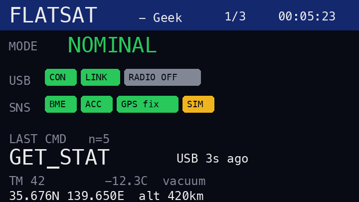
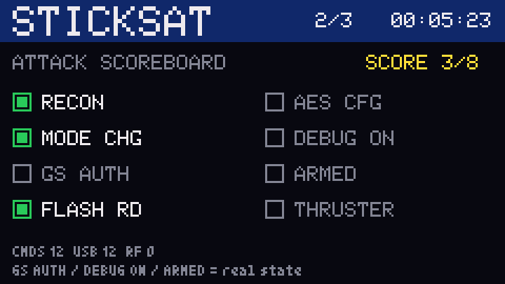
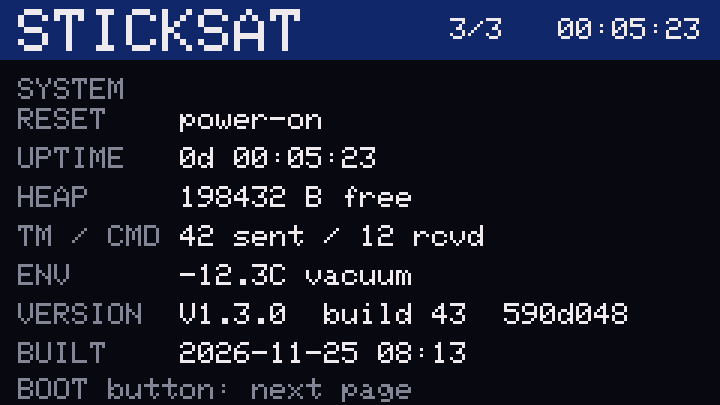

# FlatSat-Geek

[English](README.md)

Waveshare RP2350-GEEK 向けに改変した Pwnsat/FlatSat ファームウェア。
ラジオハードウェアなし、1.14" LCD にステータス画面を表示。

[Pwnsat/FlatSat](https://github.com/Pwnsat/FlatSat) (GPL-2.0-or-later)
をベースにしています。帰属表示と変更点は[ライセンス](#ライセンス)を参照。

ビルド (PlatformIO が必要):

    cd Firmware
    pio run -e pico2_geek_norf        # -> .pio/build/pico2_geek_norf/flatsat-*.uf2

書き込み: BOOTSEL を押しながら USB 接続し、`.uf2` をドライブにコピー。
ビルド済み UF2 は
[GitHub Releases](https://github.com/bellx2/FlatSat-Geek/releases) に添付。

## センサーシミュレーション (`pico2_geek_sim`)

センサー未接続のボード用。BME280、LIS2DH12、GPS の値をシミュレート
(`-DFLATSAT_SIM_SENSORS=1`)。実際の GPS が NMEA を送信している場合はそちらが優先。
画面には `SIM` チップが表示され、ブートログに `[INFO] SIM: ...` と出力される。

    pio run -e pico2_geek_sim

シミュレート GPS (`-DFLATSAT_SIM_GPS_MODE=n`):

- `0` (デフォルト): JAXA 筑波付近の円軌道 (周期 10 分、高度 420 km)。
  起動後約 30 秒で地上局ゲート (100 km) に入り、約 4 分間圏内、
  その後約 6 分間圏外を繰り返す。
- `1`: 地上局 (筑波) 上空の小さな固定軌道。ゲートは常に開いた状態。
- `2`: 東京上空の小さな固定軌道。ゲートは常に閉じた状態。

シミュレート環境 (宇宙模擬):

- 温度は日照/食の周期に追従: 影を出た直後は約 -28 C、日照の終わりに約 +65 C。
  各周回の 37% が食。`-DFLATSAT_SIM_ORBIT_SPEEDUP` で加速。
- 気圧と湿度は 0 (真空)。BME280 の高度は気圧高度のため真空では無意味なので 0 を返す。
- 加速度計はマイクロ G (自由落下): 各軸 1 mg 未満のノイズ。温度は外壁温度に遅れて追従。
- 調整パラメータ: `FLATSAT_SIM_T_HOT_C`, `FLATSAT_SIM_T_COLD_C`,
  `FLATSAT_SIM_T_TAU_S`, `FLATSAT_SIM_ECLIPSE_FRACTION`

## 攻撃演習

RP2350-GEEK (USB のみ、ラジオなし) での
[元の攻撃スクリプト](https://github.com/Pwnsat/FlatSat/tree/main/Attacks)
との互換性:

| # | 攻撃 | USB | 備考 |
|---|---|---|---|
| 00 | APID 列挙 | 可 | |
| 01 | 傍受 | 可 | RF ではなく USB 上のテレメトリをキャプチャ |
| 02 | ファジング / クラッシュ | 一部 | コマンドは受理されるが送信はブロック (`RADIO DISABLED`) |
| 03 | コマンドインジェクション | 可 | |
| 04 | GPS スプーフィング | 不可 | SDR + GPS ハードウェアが必要 |
| 05 | GS 認証スプーフィング | 条件付き | GPS が地上局範囲内 (筑波, 100 km) である必要あり。デフォルト軌道は 10 分ごとに圏内通過、または `GPS_MODE=1` を使用 |
| 06 | リプレイ | 可 | |
| 07 | RESETC | 可 | |

## 画面ページ

RP2350-GEEK の BOOT ボタンで画面を操作:

- **短押し**: 次のページに切り替え (画面上部にページ番号を表示、例: `2/3`)
- **長押し (1 秒)**: 画面を 180 度回転 (ボードを逆さまに取り付けた場合に便利)

画面は最大毎秒 2 回再描画。回転はブート画面 (`WAIT USB CONSOLE`) でも動作する。

### 1. ステータス

衛星の全体的な状態を一覧表示するメイン画面。

- **MODE**: 現在のミッションモード (`SAFE` / `NOMINAL` / `PAYLOAD` / `SCIENCE` / `CONTINGENCY`)。モードごとに色が変わる (SAFE=黄、NOMINAL=緑、CONTINGENCY=赤)。ペイロードがアームされている場合は `ARM` バッジが表示される。
- **USB**: 接続状態。`CON` (USB シリアルコンソール) と `LINK` (USB 経由のラジオリンクエミュレーション) の接続状況を緑/赤で表示。`RADIO OFF` はラジオハードウェアが無効であることを示す。USB デバッグ有効時は `DBG` バッジが追加される。
- **SNS**: センサー状態。`BME` (BME280 温湿度・気圧)、`ACC` (LIS2DH12 加速度計)、`GPS` (fix / nofix / quiet / none)。シミュレーションモードでは `SIM` バッジが表示される。地上局認証中は `GS AUTH` / `GS ON` が表示される。
- **LAST CMD**: 最後に受信したコマンド名、ソース (USB / RF)、経過時間。受信直後 (1.5 秒間) は行全体が黄色にハイライト。
- **TM**: テレメトリパケット数と環境値 (温度、気圧。気圧 1 hPa 未満で `vacuum` と表示)。
- **Position**: GPS 座標 (緯度 / 経度 / 高度)。高度 10 km 以上では km 単位で表示。

### 2. 攻撃スコアボード

衛星攻撃演習での進捗を追跡するスコアボード。8 つのマイルストーン:

| マイルストーン | トリガー |
|---|---|
| `RECON` | 偵察コマンド受信 (PING, GET_STATUS, GET_NAV, PL_STAT, GS_STAT) |
| `MODE CHG` | SET_MISSION_MODE コマンド受信 |
| `GS AUTH` | 地上局セッションが実際に確立 (状態) |
| `FLASH RD` | FLASH_READ コマンド受信 |
| `AES CFG` | AES_CONFIG コマンド受信 |
| `DEBUG ON` | USB デバッグが実際に有効 (状態) |
| `ARMED` | ペイロードが実際にアーム (状態) |
| `THRUSTER` | SET_THRUSTER コマンド受信 |

コマンド系マイルストーン (RECON, MODE CHG, FLASH RD, AES CFG, THRUSTER) はコマンド
受信時にチェックされる。状態系マイルストーン (GS AUTH, DEBUG ON, ARMED) は衛星が実際に
その状態にあるときにチェックされる。新たに達成されたマイルストーンは 3 秒間ハイライト表示。
カウンターはリブートでリセット。

### 3. システム

システム情報の詳細画面。

- **RESET**: リセット理由 (power-on / watchdog or soft reset via RESETC / brown-out / RUN pin)
- **UPTIME**: 起動からの経過時間
- **HEAP**: 空きヒープメモリ (バイト)
- **TM / CMD**: 送信テレメトリ数 / 受信コマンド数
- **ENV**: 環境センサー値 (温度、気圧。気圧 1 hPa 未満で `vacuum`)
- **VERSION**: ファームウェアバージョン (`version.h` の `FW_VERSION`) + ビルド番号 (git コミット数) + git ハッシュ (ローカル変更がある場合は `+` 付き)
- **BUILT**: ビルド日時 (`tools/gen_version.py` により自動生成)

## ライセンス

本プロジェクトは **GNU General Public License v2.0 or later**
(GPL-2.0-or-later) のもとで公開。全文は [LICENSE](LICENSE) を参照。

### 元のプロジェクト

ファームウェアは **astrobyte** (Cromulence / Hack-A-Sat) による
[Pwnsat/FlatSat](https://github.com/Pwnsat/FlatSat) から派生。
原著作物は GPL-2.0-or-later で公開。

### 本リポジトリでの変更点

- `radio_off.h/.cpp`, `#if FLATSAT_NO_RADIO`: SX1262 ラジオを無効化し
  ハードウェアリセット状態で保持
- `lcd_status.h/.cpp`, `#if FLATSAT_LCD_GEEK`: 1.14" LCD ステータス画面
  (ステータス、攻撃スコアボード、システム情報、MADCTL による 180 度回転)。
  SPI1 ピン: DC=GP8 CS=GP9 CLK=GP10 MOSI=GP11 RST=GP12 BL=GP25
- `orbit_sim.h`, `sensors.cpp` (`FLATSAT_SIM_SENSORS`): BME280、LIS2DH12、
  GPS のシミュレーション (ISS 相当の軌道モデルと熱モデル)
- `platformio.ini`: RP2350 / Pico 2 ビルド環境
  (`pico2_tinyusb_norf`, `pico2_geek_norf`, `pico2_geek_sim`)
- `version.h`, `tools/gen_version.py`: ビルド時バージョン注入

既存ファイルへの変更はすべて `#if FLATSAT_NO_RADIO`、`#if FLATSAT_LCD_GEEK`、
`#if FLATSAT_SIM_SENSORS` ガードで囲まれている。上流からの差分全体を確認:

    git diff cecef5f..HEAD -- Firmware/
